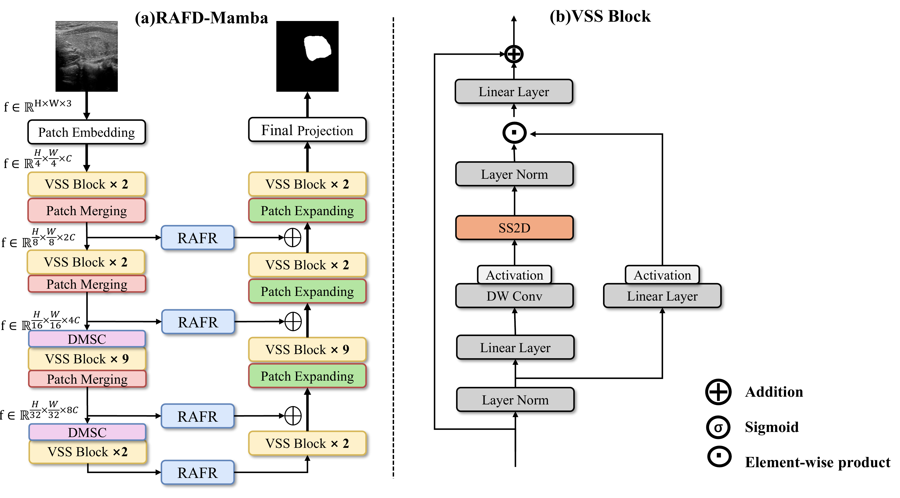
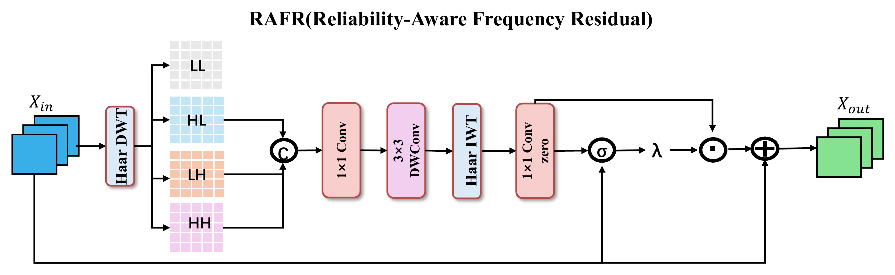
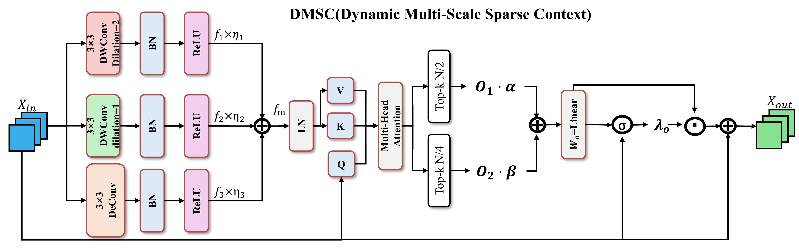

# RAFD-Mamba

Official code and figures for the paper:

> **RAFD-Mamba: A Mamba-Based Network Integrating Reliability-Aware Frequency Residual and Dynamic Multi-Scale Sparse Context for Thyroid Nodule Ultrasound Segmentation**

Yongxi Chen, Zequn Li, Min Lin

## Model overview



*Figure 1. Overall architecture of RAFD-Mamba. (a) Encoder–decoder, the two modules, and their skip-connection wiring; (b) internal structure of the VSS block.*



*Figure 2. Reliability-Aware Frequency Residual (RAFR) module.*



*Figure 3. Dynamic Multi-Scale Sparse Context (DMSC) module.*

## Repository layout

```
code/                       Python source (comments and docstrings removed; see below)
  configs.py                protocols, preprocessing and training settings
  train.py, test.py         training and evaluation entry points
  models/mybackbone.py      backbone with RAFR and DMSC wired in
  models/modules/           rafr.py, dmsc.py, wavelet.py
  models/vmunet/            VM-UNet backbone (third party)
  probes/                   scripts that regenerate the manuscript figures
figures/                    Final figures, named by their number in the manuscript
```

## Environment

- Python 3.10, PyTorch (CUDA), single NVIDIA GPU
- Key packages: `torch`, `torchvision`, `numpy`, `albumentations`, `opencv-python`,
  `einops`, `timm`, `mamba-ssm`, `scikit-learn`, `matplotlib`, `Pillow`
- The selective-scan CUDA kernels of VMamba are required
  (`mamba_ssm.ops.selective_scan_interface`).

```bash
pip install -r requirements.txt
```

## Data

- **TN3K** (official fold0): 2303 / 576 / 614 images for train / val / test
- **TNUI-2021** (cleaned public mirror): 966 / 272 / 139 images
- **DDTI** (external test only): 127 images

Preprocessing: grayscale → 3 channels, resize to 256×256, per-image min–max
normalization to [0, 255]; TN3K masks binarized at 127 and DDTI at 0.

The datasets are public and are not redistributed here. Point the code to your local
copy with `--pre-root` (or edit `PRE_ROOT` in `configs.py`).

## Training and testing

```bash
# train the proposed model (TN3K, seed 42)
python train.py --dataset TN3K --architecture mybackbone_rafr4_dmsc \
                --seed 42 --exp rafr4_dmsc --gpu 0

# test on the internal test set
python test.py --ckpt output/rafr4_dmsc/<timestamp>/best_model.pth \
               --dataset TN3K --split test --gpu 0

# external validation on DDTI
python test.py --ckpt output/rafr4_dmsc/<timestamp>/best_model.pth \
               --dataset DDTI --split test --gpu 0
```

Training settings used in the paper: 200 epochs, batch size 32, AdamW
(lr 1e-4, weight decay 1e-2), 10-epoch warm-up followed by polynomial decay
(power 0.9, min lr 1e-6), FP32 without AMP; the best checkpoint is selected by
validation Dice.

## Note on comments

Source files authored by the authors have had all comments and docstrings removed
(`ast`-based stripping; code semantics unchanged). `models/vmunet/` reproduces the
VM-UNet backbone (VMamba encoder and VSS decoder) and is kept verbatim with its
original attribution header, as required by its license. Everything else in
`code/models/` implements the two modules of this paper: RAFR in
`models/modules/rafr.py` (+ the Haar transform in `wavelet.py`) and DMSC in
`models/modules/dmsc.py`, wired into the backbone in `models/mybackbone.py`.

## Figures

| File | Manuscript | Content |
|---|---|---|
| `Figure1_overall.pdf/.png` | Figure 1 | Overall architecture and VSS block |
| `Figure2_RAFR.pdf/.png` | Figure 2 | Reliability-Aware Frequency Residual module |
| `Figure3_DMSC.pdf/.png` | Figure 3 | Dynamic Multi-Scale Sparse Context module |
| `Figure4_dice_hd95.pdf/.png` | Figure 4 | Dice / HD95 bar comparison on TN3K |
| `Figure5_qualitative.png` | Figure 5 | Qualitative comparison |
| `Figure6a_precision_recall.png` | Figure 6a | Pixel-level precision–recall curve on TN3K |
| `Figure6b_tsne.png` | Figure 6b | t-SNE of decoder features |
| `Figure7_gate_telemetry.pdf/.png` | Figure 7 | Gate telemetry of RAFR and DMSC |
| `Figure8_validation_curves.png` | Figure 8 | Validation Dice curves of the ablation configurations |

Raster figures are exported at 600 dpi; Figures 1–4 and 7 are also provided as
vector PDFs.

## Figure-generation scripts

`code/probes/` contains the scripts that regenerate each figure from checkpoints or
`metrics.jsonl`, e.g.:

```bash
python probes/make_compare_figure_bw.py --ckpt <run_dir> --n 4 --gpu 0 --dpi 600 --out Figure5.png
python probes/make_summary_figures_en.py          # Figure 4
python probes/make_gate_figure_en.py --out Figure7.png
python probes/make_curves.py --ablation --dpi 600 --out Figure8.png
python probes/make_tsne.py --ckpt <run_dir> --n-img 40 --per-class 50 --seed 0 --dpi 600 --out Figure6b.png
```
